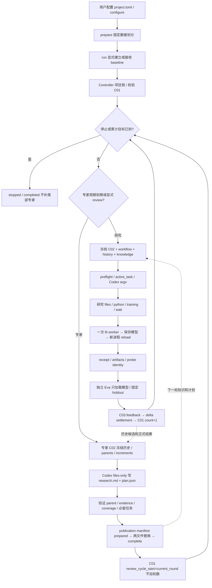

# 实际执行流、文件与合约

本页依据发布副本的实际源码整理，不是设计愿景。函数与行号见 [源码定位表](source-map.md)，完整图见 [framework-flow.mmd](framework-flow.mmd)，可离线浏览 [flow.html](flow.html)。`R` 是发布根目录，`U` 默认是 `R/workspace/runtime`，`T=U/tasks/<task_id>`；baseline 的特殊任务目录是 `R/workspace/baseline`。除明确标注外，C02 内文件引用以 `T` 为基准。

## 1. 总流

关键区别：`keeper` 从同一评价域内已验证成功结果中按 AUC 最大值推导；`parent_source` 是当前研究起点，可以由专家选择较弱的历史候选。选择较弱 parent 不会覆盖 keeper。原始 lineage 保存在 C02 的 provenance 中；本实现没有图搜索队列、节点访问策略、UCB、beam 或回溯搜索算法。

## 2. 每个阶段交接什么

| 阶段 / 写入者 → 读取者 | 文件与关键字段 | 验证 / 出错行为 |
|---|---|---|
| 用户 → config loader | `R/project.toml`：数据路径、target/id、roc_auc、seed、holdout_fraction、candidate.source、research_model/effort | 二分类/AUC 模板；不能只把 metric 名称换掉就宣称支持别的任务。模型名是用户配置，不在本代码中保证账户可用。 |
| prepare → 后续训练/Eva | `workspace/data/prepared/{research.csv,holdout.csv,split.json}` | split 绑定原 CSV、两个分区实际字节、target/id、seed/fraction、评价代码、依赖锁；重复 prepare 只验证；半成品/配置改变拒绝覆盖。 |
| 显式 run → baseline | `workspace/baseline/input.json`、其 `workspace/train.py`、`training/*`、`output/evaluation/*` | 不调用模型、不占研究轮数；已有训练回执先验证，只补 Eva；未知半成品保留并阻塞，不偷偷重训。 |
| configure/controller → controller | `U/control.json`（C01），项目级 `workspace/writer.lock` | 单写入者。C01 字节被外部改动时，不用旧内存状态覆盖。锁涵盖同项目的不同 runtime，避免竞争共享基线。 |
| backend → agent/contract | `T/input.json`（C02）、`workspace/task.md`、`workspace/history/state.json` | `workflow.file/sha256` 绑定派发前 C01 与计划投影；派发前再核对计数、目标、周期、角色模型、已消费计划。 |
| storage → transport/agent | `U/inputs/objects/<sha>.txt`；`U/inputs/history.json`；`T/workspace/history/index.json` | 对象按内容寻址；index 的 `path_base=task`、records、content_sha256 冻结本任务选择的逻辑历史；catalog 可追加，但已选内容不能改。 |
| backend → research agent | C02 `source_files`（parent/best）、`knowledge_files`、`data`、`training`、`provenance` | parent 必须来自当前评价域内已验证历史；专家证据投影加入可读列表。复制训练分区和 probe，原输入在会话前后校验哈希。 |
| session helpers → Codex | JSON argv、stdin prompt；`workspace/output/{stdout.jsonl,stderr.log,final.txt}`；`T/session.log` | 禁用其他 agent、apps、shell 等旁路；只接一次已返回结果。明确未创建进程可按继续命令启动；started/unknown/失败结果不自动重放。 |
| transport → 文件/子进程 | `files/python/training/training_status/wait`；`workspace/output/process-events.jsonl`、`processes/*` | 专家仅 files；研究仅可通过文件工具改候选和 scripts。JSON argv 不拼 shell。工具进程结果包含 cwd；输出文件描述包含 path_base、required、exists。 |
| training supervisor → fit worker | `training/fit_request.json`、`training/train.py`、`artifacts/*`、`fit_predictions.npy` | AST 源码指纹去掉格式/注释重复；只调一次 fit_predict；单任务 fit+reload 共享墙钟预算。未知已有 artifacts 不覆盖。 |
| training supervisor → reload worker | `training/predict_request.json`、`predict_predictions.npy`、`probe.json` | 新进程调用 predict_saved；预测形状/有限性、数值一致性、源码和模型字节验证。已有 receipt 在 import 候选之前验证返回。 |
| training → backend/Eva | `training/receipt.json`：task_id、status、source_sha256、training_input_sha256、probe hashes、artifacts、probe_reload_verified | success/duplicate/model_failure/timeout 各有明确含义；完整性损坏不能降级为普通失败；不覆盖旧成功回执。 |
| backend → Eva process | 根目录 `evaluate.py --task T --project-root R --output ...` | 外部进程只调用保存候选的 predict_saved；验证科学域、回执、源码、模型、probe；本流程不调用 fit_predict。 |
| Eva → controller | `workspace/output/evaluation/{metrics.json,train.py,predictions.npy}` | metrics 的 run_id/status/roc_auc/reload_verified/input/source/probe/artifact/split/prediction hashes 必须一致；已有完整 Eva 只验证接收，不重新预测。 |
| backend → controller | `T/feedback.json`（C03）：严格五字段 task_id/status/score/artifacts/error | 只有研究 success 有有限 AUC；duplicate/model_failed 及 review 的 score 都为 null。进程事件的阻塞错误在接收已有 C03 时仍检查。 |
| controller → 下一轮 | `T/delta.json` → `U/control.json` | delta 先写，settlement 绑定 input/feedback 哈希与 research_round；随后 C01 加一次并清 active_task。恢复时同一个 delta 必须完全一致。 |
| expert prepare → expert | C02 `review`：parents、knowledge_before、increments、unfinished_tasks、optional_files、max_next_tasks | 每个 parent 同时绑定冻结源码、原历史源码、正式 metric 的哈希。专家没有训练/进程工具。 |
| expert → publisher | `T/workspace/output/research.md`、`plan.json` | plan 仅 next_tasks/optional_files/covered_delta_ids；任务仅 question/parent_source/evidence；由程序分配 ID；必留用户任务不可静默丢弃。 |
| publisher → 活动知识 | `T/publication/{research.md,accumulated.json,manifest.json}` → `U/knowledge/{research.md,accumulated.json}` | manifest 先记录旧/新哈希、目标、输入/输出身份和分配 ID；逐文件替换；complete 后不覆盖人工修改。中断只续同一清单，不重复专家调用。 |
| publisher → 下一研究 | accumulated.next_tasks/review.covered_delta_ids；C02 provenance.evidence_files | 已完成/待执行由 C01+C03+delta 推导，不按 Markdown 标题判断；研究用 current_task，知识正文提供参考；专家不直接改 C01。 |
| 用户 → predict CLI | `predict.py --task T --input CSV --output CSV` | 先验证已保存训练，导入该轮冻结源码；校验概率与 ID 顺序、模型不变、CSV 往返；不拟合，不覆盖原输入/任务证据或已有导出。 |

## 3. 同步字段与真正的权威

| 权威 | 字段 / 关系 | 不应混淆的内容 |
|---|---|---|
| C01 | current_round/target_rounds 是累计已接收研究数；review_every/review_cycle_start 决定 due；active_task/next_step/status 决定恢复点；models 绑定显式角色配置 | 基线和专家不增加研究轮数。失败/重复若被正式接收也占一轮。status 不是科学结论。 |
| C02.workflow | file + sha256 → frozen control、current_task、pending/completed、latest_research、uncovered_delta_ids、knowledge_json_sha256 | 这是派发前的只读投影，不是第二个可写控制文件。知识 prose 不拥有调度权。 |
| C02.provenance | question、parent_source/parent_sha256、review_task_id、knowledge_sha256、evidence/evidence_files | parent 不是 keeper。证据路径不是研究正确性的证明；哈希仅证明字节身份。 |
| 训练回执 ↔ Eva ↔ C03 | task/input/source/probe/artifact/split 身份；metric.roc_auc = feedback.score | 模型声称的分数、stdout、final.txt 均不能充当正式分数。 |
| delta.settlement ↔ C01 | 连续唯一 research_round；input_sha256/feedback_sha256；已提交数量等于 current_round | 已存在的 active task delta 可以尚未计数，恢复必须处理这个窗口。 |
| expert manifest ↔ accumulated | outputs 哈希、knowledge_before/new、assigned_task_ids、review.task_id、covered_delta_ids | 两文件替换是可恢复事务，不是跨文件原子操作；磁盘上短暂可见一新一旧，控制器单写入者及清单负责恢复。 |

## 4. 已定位并修正的 bug 来源

1. **路径拼接不一致**：baseline 少一层 workspace、review 路径重复拼 output；改为统一任务基准并用合成闭环验证。
2. **存在文件被误当作初始化已完成**：configure 创建 C01 后阻止首次 baseline；改为显式 run 授权，receipt 决定恢复与禁止重训。
3. **状态记录之间自述一致，实际字节不一致**：补实际模型、候选、probe、正式预测的哈希校验；损坏注入会被拒绝。
4. **重载验证依赖同一进程全局变量**：fit 与 reload 分进程；Eva 再独立加载保存候选。
5. **证据虽被复制，却不可读**：专家 evidence_files 必须加入下一轮 knowledge_files；history index 和 tool example 也显式暴露。
6. **哈希丢失使重复检查失效**：results 保留 train_sha256，任务同时传源码字节哈希与 AST 指纹。
7. **错误分类旁路**：去除旧批次 driver；只读 files 错误保存诊断，任意 Python 非零/未结算/写入拒绝保守阻塞；接收已有 C03 仍验证。
8. **诊断事件破坏返回判定**：不再把诊断追加为 session.log 的最后一个非 returned 事件，独立写 diagnostics.json。
9. **导出用模板而非真实候选**：predict 读取指定 task 的保存源码/模型，并保持 ID 顺序。
10. **不同实验域混合比较**：固定实际数据字节、配置、评价代码和锁文件，历史只取同域记录；换科学设定应建立独立项目。

## 5. 仍会出现问题的地方

- **研究决策**：允许读取历史、选择历史 parent、更新知识，不保证 agent 会读全、正确归因或走出局部优化。专家也会重复错误；代码没有自动判定“新机制”的科学有效性。
- **评价设计**：同一 holdout 被多轮选择，会产生适应性过拟合；没有内建统计校正、嵌套验证、独立最终测试或跨 seed 结论。框架保持协议，不保证实验设计合理。
- **隔离边界**：MCP 文件白名单限制正常工具接口；候选和 inspection Python 仍是本机进程。命名 fit 的拦截不是安全证明，无法保证恶意/不守约代码不另行拟合、联网或访问 holdout。只运行可信候选，需要监督。
- **预算边界**：一次 fit_predict 调用和 fit+reload 墙钟预算，不是内层每次模型.fit 的精确预算计量；没有 GPU/显存/内存硬配额。Windows 是首版支持范围。
- **外部模型接口**：沿用原 Codex argv 路线；本次替身替换 preflight/invoke，没有验证真实 Codex 版本、模型权限、MCP 启动或长会话行为。help 成功不等于端到端可用。
- **保守阻塞**：未知调用、半成品 baseline、写入/任意 Python 失败、破坏的发布身份会停止，需要人工诊断。没有自动重试或通用修复服务。
- **观察和崩溃窗口**：跨文件更新可中断；已检查部分关键窗口，不是所有文件系统故障和断电场景的形式证明。任务历史全量校验与完整上下文也会随轮数变慢、增加 token。
- **共享基线**：同发布目录的多个 runtime 共用数据和 baseline；项目级锁避免同时写入，但不同科学任务请复制成独立项目，不能把 runtime 参数当多租户隔离。

验收范围、实际结果及未测项目见 [validation.md](validation.md)。本发布副本没有携带开发测试、比赛实验或 GUI。
