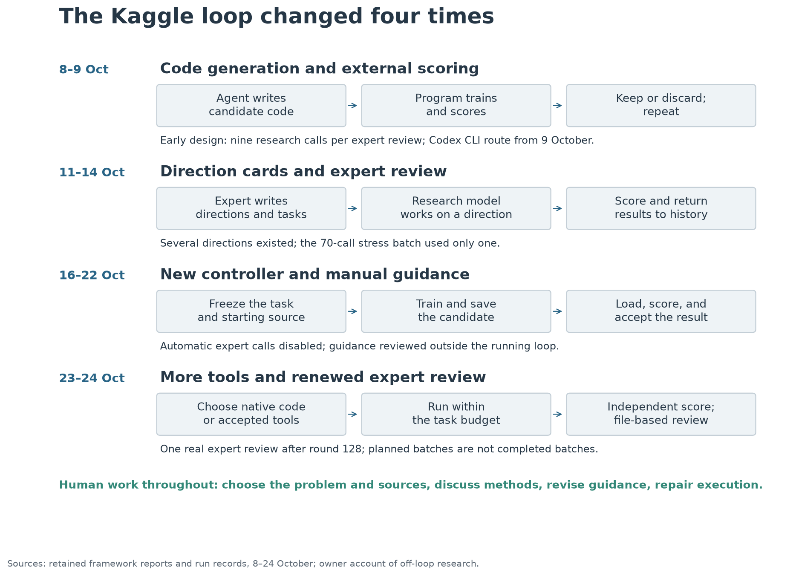
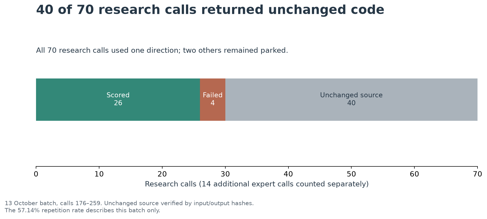
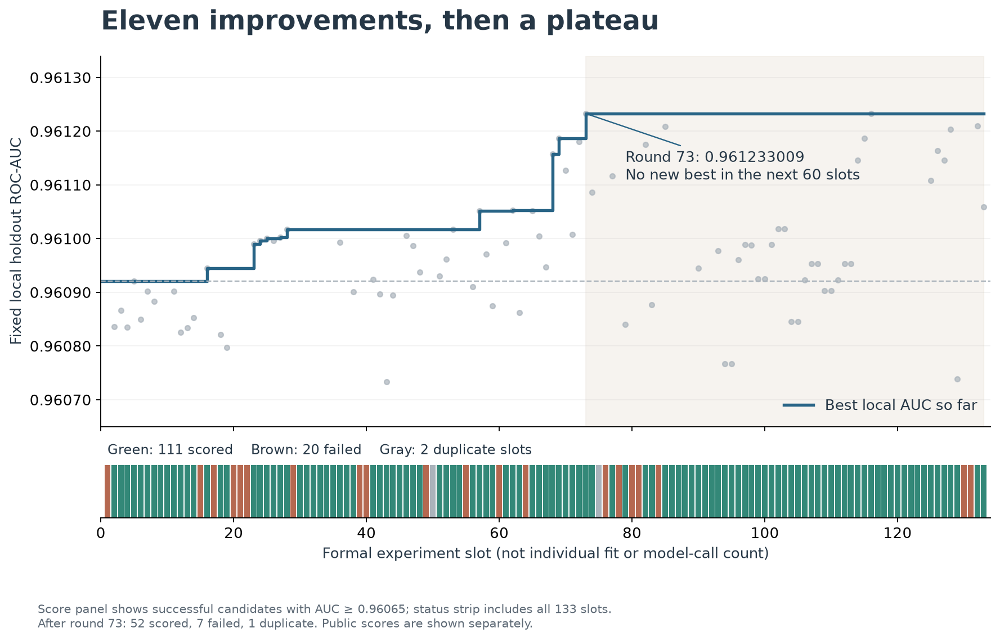
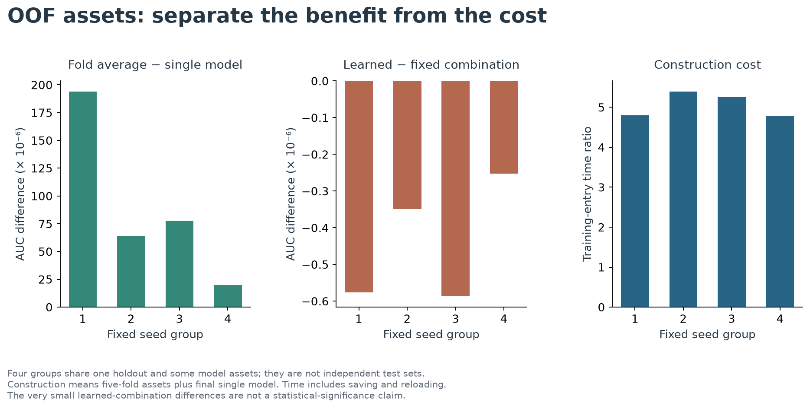
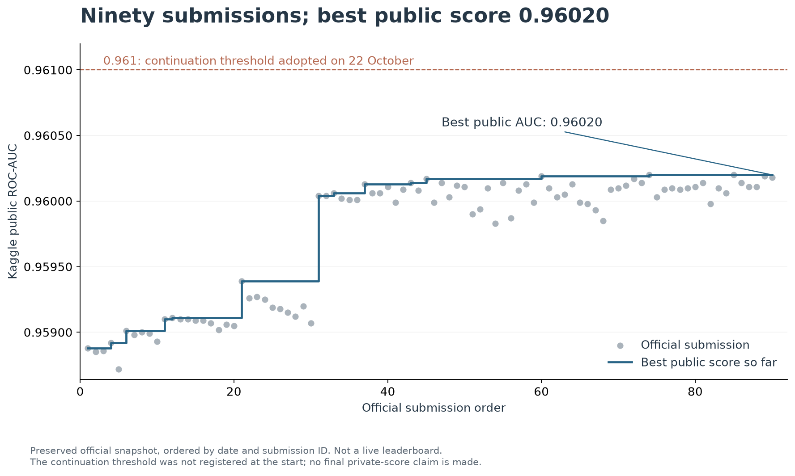

# A personal test of autonomous machine learning

From TrafficFlowBench to a Kaggle research loop, September–October 2026

Technical report · Public working draft v0.1 · 29 October 2026

By [nxsyy55](https://github.com/nxsyy55) · [Framework repository](https://github.com/nxsyy55/simple-expert-modeling-loop) · [Corrections and discussion](https://github.com/nxsyy55/simple-expert-modeling-loop/issues)

*This draft is under author review and has not been peer reviewed. English is the working version; a Chinese edition is planned after revision.*

My starting point was skepticism about a promise circulating around AI research loops: give an agent a goal, let it generate and test changes, and useful progress will continue without much human involvement. The promise was being extended well beyond the small training experiments that made the pattern easy to demonstrate. I wanted to know what an individual could actually obtain from it using publicly available tools and a personal subscription, without a model company's internal research infrastructure.

Two examples in my retained source collection capture the language I was questioning. In a 17 March 2026 X article about improving Claude skills, Ole Lehmann wrote that the method “works on anything you can measure and improve” and described a copywriting-skill result achieved “With zero manual work at all.” A separate X post by Varun Mathur presented a generalization of autoresearch in which a user could describe an optimization problem in ordinary language and a distributed swarm would work on it. It claimed the system “compounds intelligence across all domains.” The post was quoted by Brian Roemmele on 15 March. These are examples of the public framing, not a claim that either post alone caused me to start the project. [Lehmann's original post](https://x.com/itsolelehmann/status/2033919415771713715), [Mathur's original post](https://x.com/varun_mathur/status/2032671842230501729), [Roemmele's quoted post](https://x.com/BrianRoemmele/status/2033064338685309274).

The distinction between a specific demonstration and a general promise matters. Lehmann reported an improvement on his own skill checks; Mathur described an optimization network. Neither excerpt literally establishes that an AI loop can solve every problem. My objection is to the inference these broader formulations invite: once a task can be scored, sustained, useful improvement is available simply by putting an agent in a loop. The work of selecting the task, constructing a meaningful test, supplying information, and deciding when the search has become unproductive can disappear from that account. I was not prepared to assume that this work would disappear from mine.

*Source note: the X excerpts above are taken from retained text captures, with matching text found in publicly indexed mirrors during this revision. Direct retrieval of the X pages returned access errors on 29 October. They are attributed quotations, not screenshots or a claim of fresh visual verification. The source audit (retained locally; not included in this public draft) records the provenance and limits.*

Company research announcements raised a related but different question. A result produced with an internal model, custom execution software, selected research problems, and specialist support cannot simply be treated as a demonstration of what a subscriber receives. OpenAI's April 2026 GPT-5.5 announcement, for example, explicitly identifies an internal model version and a custom harness in its account of a Ramsey-number proof. That is a concrete reason to ask which parts of a reported capability are available outside the laboratory. It is not a reason to dismiss the proof. [OpenAI's account](https://openai.com/index/introducing-gpt-5-5/)

The same distinction requires care with Claude. Anthropic's September announcement distinguishes generally available Fable 5.1 from Mythos 5.1, available through trusted-access programs, even while describing them as the same model with different safeguards. Restricted access is therefore not automatically evidence of undisclosed, more intelligent weights. Nor are all scientific harnesses private: an October guest article hosted by Anthropic describes the open-source BootLoops toolkit and the domain-expert steering needed to turn initially unremarkable connections into useful scientific questions. These cases make a blanket claim that all company discoveries depend on secret models and secret harnesses untenable. They do leave the practical question open: can an ordinary user reproduce the useful behavior with the accessible model, tools, information, and budget? [Anthropic's model and access description](https://www.anthropic.com/claude-fable-and-mythos-5-1), [BootLoops account](https://www.anthropic.com/research/claude-shaped-science).

This report examines that accessible setting. “Ordinary user” describes my access and resource constraints, not a statistically representative sample of users or an average level of human ability. I had domain judgment, AI-assisted development, and outside research support; I did not have access to the internal setup behind the cited proof result. I was interested in the gap between a public claim of capability and a workflow I could afford to use, including the effort needed to construct and supervise it.

In September, I narrowed that question to a test with an answer I could check. Asking a model to discover something important seemed too vague. If the result disappointed me, there would always be an argument about the question, the definition of novelty, or the quality of the judgment. I wanted a task on which a failed attempt could be recognized and progress measured without asking another language model whether it sounded convincing.

My discussions with AI assistants produced a useful distinction: generating a candidate, searching among candidates, and judging a candidate are separate jobs. The shorthand was “AI Research = Generator × Search Loop × Evaluator.” This was a way to organize the question, not a mathematical law. A language model could write plausible code; a program could run it repeatedly; an evaluator could score the result. The unresolved issue was whether joining those parts would produce useful research at a cost an individual could afford.

The surviving reconstruction of those September conversations places the first discussion on 15 September and a four-level classification on 17 September. It also records a warning on 16 September: a strong evaluator and more computation do not guarantee good ideas. I was therefore testing a proposition whose weaknesses were already visible. The confident recommendations came from the AI assistants. My role was to find out how much confidence the evidence justified. [1](#s1)

| Working level | What is specified? | Examples discussed | What a successful system would need to do |
|---|---|---|---|
| 1. Verifiable optimization | The objective is known and evaluation is reasonably reliable | Bounded coding tasks, formally checked mathematics, competition modeling | Find better solutions within an explicit test protocol |
| 2. Optimization with uncertain judgment | The objective is known, but its measurement is incomplete or subjective | Model-based judging, preference or reward models | Improve the intended outcome without merely exploiting the proxy |
| 3. Hypothesis formation and testing | The question is still being refined, but experiments can test claims | Scientific and causal discovery, some active-learning settings | Propose useful hypotheses and design informative tests |
| 4. Open-ended inquiry | Even the question worth pursuing is unsettled | Goal invention, open-ended search | Develop objectives and grounds for judging their value |

*Table 1. An edited English reconstruction of the four-level framework supplied from earlier discussions. These are working distinctions, not an established ranking of all AI tasks. A task can move between levels as its scope changes.*

I began near the first level. Before accepting claims about open-ended research, I wanted evidence that a loop could do useful work when the objective and feedback were unusually clear. This was a practical test sequence, not a theorem that every creative task must first pass a machine-learning benchmark.

Six weeks later, I had abandoned an ambitious traffic-modeling project and completed a narrower series of machine-learning experiments. The later project's archive contains 306 entries across several evaluation and execution regimes. Some represent failed attempts, some deliberate controls, and some duplicate work; they are not 306 independent scientific ideas. There were genuine improvements. There were also long periods in which running another iteration produced no new best result, and episodes in which the system kept asking a model to perform work that it had already done.

My conclusion is that the version of the AI-loop proposition I tested was false in practice: connecting an agent to feedback and repeated execution did not give me a research worker whose judgment justified the cost of building and supervising it. I now prefer to use my own domain judgment to direct a coding agent. That is a decision based on this experience, not a measured victory over every autonomous research system.

The experience also sharpened a suspicion about the models themselves: under these conditions, repeatedly asking for the next improvement often brought the system back to familiar recipes and nearby variations. Perhaps the loop was repeatedly drawing from a limited set of readily proposed ideas without a strong enough mechanism for leaving it. I regard this as a hypothesis about proposal diversity, not evidence that an LLM has the intelligence of an “average human.” Repetition in this project has several documented causes, including conflicting instructions and constrained tools. Calling it statistical regression to the mean would imply a measurement that I did not perform. What I can show is how often the available system returned to completed work and how much human direction was still required to make progress.

## Choosing a test with a clear answer

The evaluator discussion was more detailed than the phrase “strong feedback” suggests. We considered several ways of checking an AI's work. A proof checker can verify a formal statement under its rules. An engineering simulator can test a design against its model of the world. A learned predictor can estimate a property. A physical experiment can measure an outcome. Human responses and market behavior can provide evidence about preference or value. Each supplies a different kind of answer, with different costs and blind spots.

| Evaluation method | What it can establish | What remains outside the check |
|---|---|---|
| Formal checks and software tests | Compliance with specified rules or test cases | Whether the specification captures the whole task; untested behavior |
| Physics or engineering simulation | Performance within the simulator | Errors in the simulator and transfer to the physical system |
| Learned predictors | An estimate based on learned relationships | Model error and unfamiliar inputs |
| Automated physical experiments | Measured outcomes under controlled conditions | Measurement error, cost, and whether the experiment answers the right question |
| Human or market feedback | Observed responses to an intervention or product | Confounding, noisy preferences, and disagreement about value |

*Table 2. The evaluator categories recovered from the September discussions, with their limitations made explicit. The original reconstruction used stronger reliability labels; this draft avoids treating a compiler, a unit test, and a proof checker as interchangeable guarantees.*

Competition modeling seemed a favorable setting. The task comes with data, an output format, and a numerical score. There is an extensive stock of existing methods. Experiments can be repeated, and a change can be compared with an earlier model. That does not make the research easy, but it removes some ambiguity about what the system is supposed to achieve.

One AI recommendation was more decisive than this cautious reasoning. The table below is a historical recommendation I supplied for this account. Its dates and full surrounding conversation remain incomplete. The money and eligibility statements are reproduced as advice given at the time, not as verified current competition information. These were options we discussed, not the competition used for the later 306-entry ledger.

| Competition considered | AI's loop-suitability rating | Estimated cost | Reward described in the advice | Mainland China eligibility as stated | Recommendation at the time |
|---|---|---|---|---|---|
| Kaggle Kaggriculture | Extremely strong | Low | $50,000 plus Kaggle points and medals | Eligible | Worth trying now |
| Topcoder Marathon Match 167 | Extremely strong | Usually low | Mainly long-term rating and annual prizes | Eligible | Evaluate immediately after the 7 October release |
| Solar Filament | Strong | Low to medium | $3,000, no Kaggle points | Eligible in principle | Keep as a backup |

*Table 3. Translation of the supplied historical recommendation. It is evidence of the advice I received, not evidence that the advice was correct.*

“Extremely strong” described suitability as though a clear score also established a favorable return on effort. That was the step I wanted to test. A good evaluator may let us reject a bad model quickly. It does not tell us how often the generator will propose something worth testing, or how much work will be needed to keep the search from repeating itself.

## TrafficFlowBench was the more ambitious attempt

TrafficFlowBench, or TFB, tried to cover several connected traffic-modeling problems: reconstructing traffic conditions, predicting queues, checking physical consistency, and inferring origin–destination flows, meaning how traffic moves between starting points and destinations. This was much broader than improving one classifier. It also put several kinds of work into the same project: data preparation, scientific validation, model development, tool integration, and the construction of the research loop itself. [2](#s2)

The earliest verified repository commit is dated 3 October. Earlier plans existed, so that date should not be read as the beginning of the whole investigation. The initial system used OpenResearch to manage experiments, with AI-assisted supervision and different models assigned coding and review roles. Later it was rebuilt around a simpler local arrangement: an agent changed model code, a fixed program evaluated it, and Git preserved the changes and results.

TFB did produce models and predictions. The archive records a complete baseline covering ten road directions and two output splits, totaling 6,980,503 prediction rows. It also records a temporal interpolation candidate and a candidate combining graph-based residual modeling with a reinforcement-learning correction. These are useful achievements, and they matter to the diagnosis. The project failed to deliver a stable, low-supervision research tool across its intended scope; it did not fail because nothing ever ran.

One review captured the mismatch between activity and output. In a window of roughly 150 minutes, there were seven OpenResearch jobs, including audits, failures, and cancellations. The review identified three useful mechanism results, but no new reinforcement-learning training and no new complete candidate. Effective model jobs occupied about 59.4 minutes, or 39.6% of the window. That time included reading, solving, and evaluation, so it cannot be called pure training time. One fixed-parameter origin–destination comparison alone took about 50.7 minutes. Both computation and coordination contributed to the low throughput.

| TFB stage | What actually worked | What was still missing |
|---|---|---|
| Baseline and initial models | Complete prediction output, interpolation, and a graph/residual/RL candidate | A dependable process for continuing research across the full task |
| AI-supervised OpenResearch workflow | Individual jobs and traceable experiment records | Automatic transitions between research decisions without repeated supervisory conversation |
| Framework and offline tests | Simulated result handling and local checks | A connected live executor; passing fixtures did not prove real research execution |
| Real parameter loop | Two actual evaluations with automatic discard/keep decisions | Freedom to propose and implement broader model changes |
| Expanded campaign | Six real evaluations across RL, queues, and traffic state; two RL runs of 20,000 training steps each | Low-supervision operation; repairs and manual intervention remained necessary |
| Direct local code loop | A candidate reached evaluation in the final attempted run | Completion: tool-permission errors and the stopping policy interrupted the run |

*Table 4. TFB's development, reconstructed from its archived history and closeout. Training steps, evaluations, model proposals, and AI requests are different counting units.*

Several setbacks were ordinary software problems, but they had direct consequences for the research claim. One early loop executed a proposed experiment and exited without producing the next research task. Another version passed dozens of offline tests while its live executor was still unconnected. A later parameter loop was real, but supported a much narrower operation than the requested ability to change model code. These distinctions were sometimes documented; they nevertheless required further intervention before the system approached the intended workflow.

The final run on 7 October failed for a particularly concrete reason. A file-access rule used absolute paths where the coding tool's permission matching expected relative paths. The agent eventually worked around the read problem and submitted a candidate. Evaluation began, but the supervisor counted seven related tool errors toward a stopping threshold and terminated it before a final score was produced. This run cannot establish that the model had exhausted useful ideas. It establishes an integration defect and a stopping decision. [3](#s3)

My contemporaneous feedback recorded public scores of 0.67124 for the RL prototype and 0.67148 for the ordinary candidate. Those values survive as reported feedback, not independently rechecked official receipts in this account. They give context for my dissatisfaction, but they do not prove that reinforcement learning was the wrong method. Nor should the RL used inside a traffic predictor be confused with a proposed learning mechanism for choosing research directions. A system can train a policy for correcting traffic estimates without learning how to conduct research.

I stopped TFB because the combined engineering and supervision burden was exceeding what I wanted to invest. The project was retired on 7 October. Narrowing the next test was a way to reduce that burden and make the results easier to interpret. Instead of several coupled traffic objectives, I would ask the loop to improve one familiar prediction task. It still would not become a perfectly controlled scientific study: the software, guidance, and model choices continued to change. It would, however, remove several sources of uncertainty at once.

## A simpler machine-learning loop

The next task was Kaggle Playground Series S6E10: predicting passenger satisfaction from passenger and service-related tabular features. Candidate models were compared using ROC-AUC, a measure of how well predictions rank positive examples above negative ones. A score of 0.5 corresponds to random ranking and 1.0 to perfect ranking. Small differences near 0.96 need careful interpretation; the number alone does not show whether an improvement will survive on other data.

A holdout set is a portion of labeled data withheld from fitting a candidate and used to score it. Keeping that split fixed makes candidate comparisons more consistent. The later production loop used such a fixed local evaluation. Kaggle's public leaderboard supplied a separate score on competition data. These two numbers must remain separate throughout the account.

The design followed the same broad idea as Karpathy's autoresearch: let an agent change training code, run a bounded experiment, measure the result, and retain or discard the candidate. In the original repository, the example uses a five-minute training budget and a human-maintained instruction file. My implementation adapted the pattern to a different modeling problem and added research directions, expert reviews, persistent state, saved-model checks, and more tools. This is a design relationship, not a claim that my repository was a verified code fork. Adding features also does not establish that it was a better research system. [autoresearch repository](https://github.com/karpathy/autoresearch)

The word *harness* can make the arrangement sound more mysterious than it is. Here it means the surrounding software that supplies files and instructions, starts the agent, runs code, collects results, and decides what happens next. A coding agent already has some of these facilities. I was adding a layer tailored to machine-learning experiments. The important question was whether this additional layer would save enough research effort to justify maintaining it.

At its simplest, the process was:

> Read the current task and previous results → write a candidate → train and save it → score it → retain the best eligible model → choose the next experiment.

The model proposed a change. A separate program established what actually happened. A persuasive explanation was not a score, and a successful process exit was not sufficient evidence of a valid model. The saved model had to load and produce the predictions that were being evaluated. These checks were valuable; the problem was what the loop chose to do with their results.

*Figure 1. Four documented stages of the Kaggle implementation. Human research and guidance continued across all four. The dates describe this project, not a general sequence that all research agents follow.*

The early documented implementation already included two loops: several ordinary research calls followed by an expert review. Its initial cadence was nine research calls to one expert call. On 9 October, the planned OpenCode/DeepSeek route changed to the existing Codex command-line route, using the model roles recorded as Luna and Sol. These names identify the execution and review models in the archive; they are not additional machine-learning algorithms. [4](#s4)

By 11–14 October, direction cards gave the system several possible research routes. Each could have its own starting model and tasks. The intended advantage was straightforward: the ordinary researcher would investigate a route, while the expert would inspect the wider picture and redirect work when local changes stopped helping. The archive also recorded which parent source each candidate inherited. A branching record is useful for tracing an experiment, but it is not itself a tree-search algorithm. The program still needs a policy for deciding which branch deserves the next unit of computation.

On 16 October, a new controller replaced the older execution entry point. Automatic expert calls were disabled, and I reviewed guidance with AI outside the running system before resuming it. Later revisions made the separation between execution facts and research advice more explicit. A fixed input package described the current task; the agent trained and saved a candidate; an independent evaluator loaded it; the controller checked the result's identity before accepting it. The internal files were called C01, C02, and C03. For the reader, their roles are simpler: current state, frozen experiment input, and official result.

The last stage added more modeling tools and restored a file-based expert review. Even the expert's plan had to be checked and published before it could affect subsequent tasks. This protected the execution record from a model's fallible summary, but it also added another set of interfaces to maintain. The original detailed flow diagram (retained locally; not included in this public draft) remains useful as a technical appendix. It documents the observed round-132 path; that observation did not exercise the expert branch or fully show the outer batch driver's stopping logic. [5](#s5)

## The expert work outside the system

Counting expert-model calls understates how much guidance the loop received. Early on, I was doing research outside it, with AI assistance. I supplied addresses of articles and discussion threads, asked for their contents to be examined, and discussed which methods were worth trying. The colleague working on the framework also researched methods with AI while developing the software. We manually updated the guidance that later runs consumed.

The archive preserves some of this path. Its community-method notes include material I supplied from discussions and notebooks. A later capability review found that one research call had used this material, and a production experiment explicitly referred to a community encoding method. The model did real implementation work, but the route by which the information entered the system was partly human-directed. [6](#s6)

| Contributor | Work performed | What the record does not establish |
|---|---|---|
| Me, using AI outside the loop | Choosing the problem, identifying sources, discussing methods, revising guidance | That the loop independently discovered those sources or priorities |
| Framework development and associated research | Fixing execution and input delivery, studying methods, updating instructions | A clean division between engineering time and research time |
| Expert model inside the loop | Reviewing results and writing plans or direction updates | That an accepted plan led to useful changes in search behavior |
| Research model | Implementing candidates, running permitted experiments, interpreting feedback | That every implemented hypothesis originated with the model |

*Table 5. The sources of research labor. The available records do not support assigning numerical shares of credit.*

There is nothing improper about using community work. Human researchers do so, and an autonomous agent should be allowed to retrieve useful methods. The distinction matters when describing autonomy and cost. A result partly produced by a person selecting sources and rewriting guidance should not become a story in which a model received a goal and found the path alone. I wanted help with choosing the next question and remembering what failed, as well as help writing code. Those responsibilities repeatedly returned to me.

## What the 306 records contain

The combined ledger has 173 records from the older experiment system and 133 slots from the later controller. The stages used different evaluation arrangements. The earliest holdout, the three-fold cross-validation stage, and the later production holdout cannot be joined into one continuous score curve. Cross-validation divides the data into several parts and rotates which part is withheld; its average is a different measurement from the score on a single fixed holdout. [7](#s7)

| Stage in the archive | Formal entries | Successfully scored | Failed | Duplicate slots | Highest recorded AUC within the stage |
|---|---:|---:|---:|---:|---:|
| Initial holdout | 51 | 51 | 0 | Not counted separately | 0.960218883 |
| Three-fold cross-validation | 35 | 34 | 1 | Not counted separately | 0.959813967 |
| Revised holdout | 30 | 30 | 0 | Not counted separately | 0.960360066 |
| Older production loop | 57 | 53 | 4 | Not counted separately | 0.960921085 |
| New controller | 133 | 111 | 20 | 2 | 0.961233009 |
| Total | **306** | **279** | **25** | **2** | Not a combined metric |

*Table 6. Counts reconstructed from preserved metrics, feedback, and execution records. Duplicate calls rejected before training in the older system are not counted as experiment entries here. A controller slot can contain more than one internal attempt or fit.*

“Successfully scored” means the experiment produced an accepted result. It does not mean it improved the model. The failure labels also changed between systems. One later failed slot was subsequently evaluated from its saved model and submitted to Kaggle; that recovery did not erase the original failure. Keeping these distinctions makes the totals less dramatic, but it prevents a misleading experiment-success rate from being built out of incompatible units.

## When the loop repeated completed work

On 13 October, the system reached formal model call 203. The requested encoding change was already present in the source given to the model, which returned the code unchanged. Call 211 reported that its requested change had already been evaluated and discarded. Call 227 identified another completed experiment. Call 239 noted that the requested five-fold inference average had already been implemented and retained. The instructions continued to return. [8](#s8)

Across two consecutive batches that day, 70 research calls produced 26 successful training runs, four training failures, and 40 unchanged source returns. The system also made 14 expert calls. All 70 research calls went to one direction, while two other directions remained parked. Duplicate detection saved the cost of retraining identical code, but the language-model calls had already occurred.

*Figure 2. The 40 unchanged returns are verified by matching input and output source hashes. The 57.14% repetition rate applies to this 70-call batch, not to the entire project. Expert calls are counted separately.*

There was a concrete framework defect. The program advanced a direction's parent source to the most recent candidate that trained successfully, even when that candidate had been rejected for a lower score. It did not update the experiment instruction to match. By call 259, the prose still requested a change to one earlier model, while the dispatched source came from a later model. The agent was being given inconsistent work.

That defect belongs in the explanation. It would be unfair to present all 40 returns as evidence that a language model is intrinsically incapable of novelty. Yet the review layer did not resolve the problem either: 13 of the 14 expert plans were accepted, and the batch still did not move its budget into the other directions. A valid plan file had become too weak a test of whether review was serving its purpose.

The repairs involved binding tasks to the correct source, marking work as consumed or completed, carrying negative results forward, and separating machine-maintained facts from model-written guidance. These are reasonable fixes. They are also research infrastructure that someone has to design and maintain. The simple loop diagram does not show the work required to ensure that the next task is still open, consistent with its input, and worth paying for.

Repetition took several forms. Sometimes source code was identical. Sometimes different source produced identical predictions. Sometimes the same historical knowledge was copied through successive input packages. These are different problems; the evidence does not establish contamination of the raw training data. Nor is every repeated prediction waste. The later controller recorded 100 distinct formal prediction hashes among 111 successful slots, and some repetitions were intentional cost controls. A count of unique files is not a count of independent ideas.

## Progress, and the plateau after round 73

The controller did improve the model. Its first 20 slots contained 16 successes and four failures. Round 16 used a LightGBM GOSS approach, a tree-learning variant, to raise the inherited local score from 0.960921085 to 0.960944581. The next ten slots followed an ensemble direction I had requested. An ensemble combines several models' predictions; here the agent chose members and combination details, and the best score reached 0.961017041. [9](#s9)

That period also exposed a gap in the evaluator. A rank transformation in round 28 depended on the batch of rows being predicted together. With a single input row, it could collapse to a value such as 0.5. Saving and reloading the model on the same batch reproduced its predictions, so that check did not catch the dependency. The model could pass the then-current score and persistence checks while still having undesirable behavior in use. A reliable check is reliable only for the property it checks.

The loop was not confined forever to one model family. Rounds 31–35 actually tested combinations involving CatBoost and XGBoost, histogram gradient boosting, explicit feature interactions, a neural network, and ExtraTrees. All five produced scores. Their best was 0.959265722, below the incumbent. This is evidence that the agent could implement different methods; it is not evidence that its method selection was efficient.

A more productive route introduced a teacher model trained using the original-data route documented in the project. A teacher supplies predictions that another model can use as an additional signal. Later work calibrated that signal and added conditional features. Rounds 57, 62, 68, 69, and 73 improved the local best, which eventually reached 0.961233009. Out-of-fold teacher predictions, meaning predictions made by models that had not trained on the corresponding rows, were used in the calibration work. The original-data route should not be mistaken for a new independent confirmation set. [10](#s10)

*Figure 3. Eleven updates to the inherited best model across 133 formal slots, for a local AUC increase of about 0.000311924. The score panel shows successful candidates at or above 0.96065 to make the high-score region readable; the status strip includes every slot. Failed attempts are not plotted as zero scores.*

After round 73, the remaining 60 slots contained 52 successes, seven failures, and one duplicate. None improved the local best. Some still produced useful information about tools, costs, and model recovery. The narrower finding is that successful execution continued after improvement in the main development metric had stopped. At that point, the case for another run depended on a research judgment that the loop had not made reliably on its own.

## A controlled comparison gave a more useful answer

One of the most informative later batches did not depend on open-ended proposal generation. It asked a specific question: was the cost of building reusable out-of-fold predictions justified by better combinations of models?

Out-of-fold, or OOF, prediction divides training data into folds. Each row receives a prediction from a model trained without that row. These predictions can be used to train a combining model without giving it the unrealistically favorable outputs obtained by predicting the same data on which a base model was fitted. The saved fold models can also be averaged at inference time. Those are related facilities, but their benefits should be measured separately.

Rounds 94–113 used four fixed seeds and five roles per seed: an ordinary single model; five-fold construction plus a final single model; the average of the fold models; a fixed 90/10 combination with an existing neural model; and a learned logistic-regression combination using the same OOF assets. All 20 slots eventually succeeded, although implementation repairs and an authorized connection retry were required. [11](#s11)

| Question | Result across the four groups | Decision supported by the result |
|---|---|---|
| Did averaging the five fold models help over the ordinary single model? | Mean AUC increase of 0.000088913; positive in all four groups | Keep averaging available when its cost is acceptable |
| Did the learned combination improve on the fixed 90/10 combination? | Mean AUC difference of −0.000000441; slightly lower in all four groups | No reason to make this learned combination the default |
| What did building the fold assets cost? | Mean training-entry time of 461.6 seconds versus 91.4 seconds; mean paired ratio 5.06× | Account for construction, saving, and reloading before enabling it routinely |
| Did the batch replace the existing best model? | Best AUC 0.961018539, below 0.961233009 | No new incumbent |

*Table 7. These comparisons share the same holdout and some model assets. They are not four independent test sets. Entry time includes more than model fitting; the tiny learned-versus-fixed difference is not presented as statistically significant.*

*Figure 4. Paired effects across four fixed seed groups. The learned and fixed combinations differ in their weighting method and link function, so that contrast does not isolate the mere presence of OOF data.*

This batch led to a practical decision: retain fold averaging as an option, but stop treating the tested learned combination as a default reason to build expensive assets. It did not invalidate OOF methods in general. It answered a smaller question well enough to guide work. The value came from choosing a comparison that separated mechanisms and included cost. AI helped implement and check that comparison. The question and the decision rule still required deliberate research design.

## More capable models and more tools

Later changes tried to address two plausible explanations for the plateau: perhaps the research model was too weak, or perhaps it lacked useful tools. In rounds 114–116, the research role switched to the configuration recorded as Terra/high. The three candidates changed teacher calibration by passenger class, calibration by travel purpose, and a distribution-based combination using a fixed training reference. Their public scores were 0.96014, 0.95998, and 0.96010, below the existing best of 0.96020. These were real changes within familiar routes. Three trials are too few, and too poorly matched to a control, to establish the general effect of using a stronger model. [12](#s12)

Tool expansion was similarly instructive. Rounds 117–119 had different source code but identical formal predictions. Inspection found that the tools had actually run. Each round fitted GBM and EBM candidates and selected the same 200-tree LightGBM structure. A feature transformer did not merge any categories at the chosen rarity threshold; 16 all-zero missingness indicators were removed; the one new missingness indicator was not used in any tree split. The added SHAP analysis explained the trained model and was not expected to change its predictions. This was a case of more executed machinery leaving the selected predictor unchanged. [13](#s13)

The first AutoML route also imposed constraints that limited what the trial could establish. It supplied an AutoGluon example in place of the strong parent source, while ordinary tasks could not freely select that tool path. The route allowed at most three internal fits, four CPUs, and a 600-second internal fitting budget, without exposing bagging, stacking, or hyperparameter search there. Its lower scores cannot be treated as a fair comparison of fully enabled AutoGluon against the incumbent.

After that restriction was identified, the input and guidance were changed so that the real parent model remained available and the agent could choose between native modeling, ablations, and the accepted tools. Rounds 125–128 returned to stronger existing methods and nearby changes without setting a new local best. Round 126 matched the best public score. The change widened the available choices, but the remaining trial was too small to establish what a broader search might have found. [14](#s14)

| Later addition | Verified behavior | Research outcome observed |
|---|---|---|
| TabM neural model | GPU training and scoring in rounds 86–88 | No improvement over the incumbent |
| OOF assets and saved-member reuse | Working construction, reuse, and controlled comparisons | Some value in averaging; no compelling default case for the tested learned combination |
| Stronger research-model configuration | Three delivered and scored candidates | No public-score breakthrough |
| AutoML, feature processing, and explanation tools | Actual fitting, transformation, and explanation | Added capabilities did not produce a new best model in the observed runs |
| Reintroduced expert review | A real file-based review after round 128 | Further work still encountered repeated mechanisms and execution problems |

*Table 8. Tool availability, actual use, and useful outcomes are separate claims.*

The last runs also prevent a clean story in which all software problems were solved and only model intelligence remained. Round 132 completed training, saved-model loading, independent evaluation, and acceptance, but scored below the incumbent. Round 133 also succeeded formally, then the outer batch process stopped because recovered history-inspection errors were classified as severe. The system had become capable of reliable execution along important paths while still containing faults in others. Its unproductive research periods and its engineering problems overlapped. [5](#s5)

## The score outside the development loop

The best local AUC, 0.961233009, was not the best Kaggle public score. The preserved official snapshot contains 90 unique completed submission IDs. Its highest public score is 0.96020, reached by a recovered round-76 model and by round 126. The locally best model from round 73 scored 0.96010 publicly. [15](#s15)

| Candidate | Local holdout AUC | Public AUC |
|---|---:|---:|
| Round 73, local incumbent | 0.961233009 | 0.96010 |
| Recovered round 76 | 0.961159749 | 0.96020 |
| Round 114 | 0.961145816 | 0.96014 |
| Round 116 | 0.961232995 | 0.96010 |
| Round 126 | 0.961164034 | 0.96020 |

*Table 9. Different evaluation sets selected different winners. Round 76 retains its recovery identity and original failed-slot history.*

*Figure 5. Ninety historical official submissions, ordered by submission date and ID. These are submission events, not research rounds. The 0.961 line was a continuation threshold adopted on 22 October, not a success criterion registered at the start. No final private-leaderboard conclusion is available in this snapshot.*

The difference between local and public scores does not by itself prove overfitting. Data splits and distributions can differ. Repeatedly choosing candidates against the same local holdout does, however, make that holdout part of the adaptive research process. Its reliability as a repeatable computation should not be confused with independence from model selection. Public feedback can also enter subsequent decisions; the highest score among many submissions is not automatically an unbiased estimate of future performance.

By 22 October, the stop plan asked whether new methods, model changes, and tool expansion could reach a public score of 0.961 within a bounded continuation. Not all originally contemplated batches were completed, so planned counts must not be substituted for executed counts. The results that did exist were enough for my decision to stop. I did not need to prove a universal statistical failure before deciding that another round of maintenance and search was no longer a good use of my time. [16](#s16)

## How this compares with other research agents

Adding an expert was supposed to help the system avoid the familiar weakness of greedy search: repeatedly modifying the current best solution while overlooking a route that looks worse initially but could lead somewhere better. My implementation had expert reviews and multiple direction records. Its observed behavior showed why those features alone are insufficient. The program still needed effective rules for allocating attempts, retiring tasks, returning to alternatives, and selecting changes.

Other research agents address these choices more explicitly. They also predate my experiments. AIDE was submitted in February 2025; MLE-STAR in May 2025; the AIRA study in July 2025. I should not describe their appearance as a consequence of, or a new development simultaneous with, my September–October 2026 trial.

| System | Search mechanism described by its authors | Relevant difference from my implementation |
|---|---|---|
| [AIDE](https://arxiv.org/abs/2502.13138) | Tree search over candidate programs, reusing and refining solutions | Parent-source records alone do not implement a policy for exploring a tree |
| [AIRA](https://arxiv.org/abs/2507.02554) | Joint study of search policies, including greedy, Monte Carlo tree search, and evolutionary search, with different modification operators | The way candidates are changed matters alongside the policy that chooses them |
| [MLE-STAR](https://arxiv.org/abs/2506.15692) | Web retrieval of effective methods, followed by component-specific refinement guided by ablations | External research and targeted tests are explicit parts of the system; much of mine was supplied outside the loop |

*Table 10. A comparison of mechanisms, not a head-to-head benchmark. I did not run these systems on my task under an equal budget.*

These designs are reasons to resist a universal conclusion from my case. They are also reasons to demand more than a diagram with a feedback arrow. A research agent's behavior depends on how it selects work and uses evidence. An expert prompt may help, but the existence of a review role does not establish that the search is broad or efficient. Conversely, my failed implementation does not refute results reported under different models, tasks, and budgets.

My suspicion about a tendency toward familiar proposals remains relevant here. A search policy can only choose among the candidates it obtains, and repeated near-variants can make a large call budget look more exploratory than it is. But this report does not isolate the model's proposal distribution from the effects of guidance, parent-code selection, tool constraints, or the maturity of the task. It documents the resulting search behavior. Testing whether a model-level bias causes it would require a separate comparison with those conditions held fixed; comparing the models with an “average human” would require a defined human baseline as well.

## The resource limit is part of the result

This was a small personal trial under the constraints of my Plus subscription, available hardware, and time. It felt expensive in attention and usage, but it was not a large institutional experiment. There is no complete ledger of money, electricity, or human hours. The records do contain some batch-level usage totals, and those should be reported in their own units rather than converted into an invented bill.

| Recorded resource use | Value | Interpretation |
|---|---|---|
| The 13 October batch: 70 research and 14 expert calls | 14,925,483 input tokens, including 11,816,320 cached; 184,842 output tokens | Cumulative CLI usage fields, not unique context or a cash invoice |
| The 40 unchanged-code calls within that batch | 6,913,473 input tokens, including 5,550,336 cached; 71,313 output tokens | Calls consumed resources even though no new source candidate was produced |
| OOF construction comparison | 461.6 seconds versus 91.4 seconds mean entry time | A measured cost for one workflow, not a universal multiplier |
| Human research, debugging, and supervision | No complete time ledger | Missing measurement cannot be treated as zero effort |

*Table 11. Cached input is already included in total input and must not be added again. The usage totals come from the archived 13 October report. [8](#s8)*

When I refer to a “20× plan,” my concern is the ability to buy far more opportunities to search. I am not claiming that a named plan guarantees twenty times as many useful experiments, or estimating this project's cost from a current subscription offer. More resources could have changed the outcome. A larger budget could support more branches, longer training, stronger models, better tools, and more careful engineering.

For an individual deciding whether the system is useful, however, that possibility cannot be an unlimited exemption from evaluation. If every disappointing result requires another layer of experts, a wider search, and more maintenance, the resource requirements belong in the product's description. The ability to download a framework does not mean the ability to use it effectively at an ordinary personal budget.

This also raises a distributional concern. Organizations with more computation, data, and specialist time can afford more failures and can reuse successful infrastructure across projects. If performance depends heavily on buying search opportunities, the practical advantage may concentrate even when the code is open. My trial does not prove an inevitable monopoly; that would require evidence about markets, scale, and competition. It does challenge the implication that wrapping a model in a loop gives every individual comparable access to autonomous research.

## Why I stopped building the loop

There are several ways to explain this outcome. The problem may already have been close to what the tested methods could achieve. My budget may have been too small. Task management was demonstrably defective at points. Some tool trials imposed restrictive conditions. The research model, its inputs, and the software changed over time. There was no matched control in which I used a coding agent directly for the same duration and expense. None of these limitations should be hidden.

They also do not require me to keep building. TFB showed how much effort could disappear into assembling and supervising a broad research system. The later Kaggle project reduced the task, established a functioning evaluation path, and produced real improvements. It still required substantial work outside the loop to supply sources, formulate comparisons, interpret negative results, correct tasks, and decide when to stop. In the periods where execution was working, continued iteration did not reliably produce research progress.

The practical alternative I prefer is to keep my own expertise in charge of the question and use a coding agent for implementation, literature retrieval, experiment management, and analysis. I would retain the useful automation: fixed evaluation, saved-model checks, reproducible commands, and traceable results. I would add more autonomous scheduling only when it solves a recurring problem and earns back its maintenance cost.

I still regard “AI loop” as a false proposition when it is used to imply that a general capacity for sustained research follows naturally from generation, scoring, and repetition. This project did automate substantial execution. It did not reliably take over the judgment I wanted to delegate. A stronger claim about autonomous discovery needs stronger evidence than the fact that an agent can keep running, particularly when a person is still supplying the direction, resolving the ambiguity, and paying for the failed attempts.

I stopped because the system had not made the central part of my work sufficiently easier. That is a narrower conclusion than declaring autonomous research impossible, but it is the conclusion that matters for deciding how I work next.

---

## Sources and reconstruction notes

This account is written in the project owner's first person. Motivations, judgments, off-loop labor, and subscription constraints come from the owner's statements. Operational claims come from preserved project records. The September chronology is a supplied reconstruction, not a recovered verbatim transcript. No historical training or Kaggle submissions were rerun for this article. Some large models, datasets, and prediction artifacts had already been deleted during retirement; their historical identity is supported by retained reports, hashes, and receipts where available, not by a claim that they were reloaded for this draft.

The retained local record ledger (retained locally; not included in this public draft), structured records (retained locally; not included in this public draft), public-submission snapshot (retained locally; not included in this public draft), and extraction notes (retained locally; not included in this public draft) preserve the counting rules. Figures in this English draft are redrawn from those retained summaries and records. Compact public data are available in the [numerical appendix](data/README.md); they exclude raw call text, identifiers, and private correspondence. The original detailed workflow diagram (retained locally; not included in this public draft) is retained unchanged as a source artifact. This is a public working draft with figures and compact numerical summaries. Full historical reports, raw call traces, source captures, and private conversation reconstructions are not included. The source notes identify retained materials but do not imply public access. The historical experiments used evolving project-specific implementations; they are not a validation of the extracted framework at commit 262948d.

**1. Early discussions.** User-supplied reconstruction of September discussions (retained locally; not included in this public draft). The competition recommendation table was separately supplied in the writing conversation. Exact original wording and dates should be checked against original excerpts before quoting either as a transcript.

**2. TrafficFlowBench history.** Archived history and evolution report (retained locally; not included in this public draft), project closeout (retained locally; not included in this public draft), and archive manifest and index (retained locally; not included in this public draft). The history report includes its own distinctions between fixture tests, live evaluations, and user-reported scores.

**3. TFB final failure.** Root-cause reflection (retained locally; not included in this public draft).

**4. Kaggle architecture.** 11 October project specification (retained locally; not included in this public draft), 12 October implementation handoff (retained locally; not included in this public draft), and 16 October capability assessment (retained locally; not included in this public draft). Designs and observed execution are treated separately.

**5. Final observed behavior.** Round-132 observation (retained locally; not included in this public draft), framework review (retained locally; not included in this public draft), and path/error-classification investigation (retained locally; not included in this public draft).

**6. External research inputs.** Community-method notes (retained locally; not included in this public draft) and the capability assessment in source 4. The owner's account supplements these records; no complete time or authorship allocation is available.

**7. Counts and evaluation stages.** Stage summaries (retained locally; not included in this public draft) and extraction script (retained locally; not included in this public draft). The maximum initially observed holdout score came from experiment 51; the reviewed incumbent at that point was experiment 49.

**8. Repeated work and usage.** 13 October efficiency report (retained locally; not included in this public draft), extracted legacy calls (retained locally; not included in this public draft), and earlier duplicate-root-cause report (retained locally; not included in this public draft).

**9. Early controller progress.** First 20 slots (retained locally; not included in this public draft), ten ensemble slots (retained locally; not included in this public draft), and five further modeling trials (retained locally; not included in this public draft).

**10. Teacher route.** Original-data teacher (retained locally; not included in this public draft), OOF acceptance (retained locally; not included in this public draft), and research feedback (retained locally; not included in this public draft).

**11. Controlled OOF comparison.** Full 20-slot results and cost audit (retained locally; not included in this public draft). The report preserves internal repairs and the authorized connection retry despite all slots eventually succeeding.

**12. Research-model change.** Three Terra trials and novelty review (retained locally; not included in this public draft).

**13. Identical predictions with different tools.** Rounds 117–119 diagnosis (retained locally; not included in this public draft). Tree-structure identity is a finding of the historical inspection, not a new inspection of deleted model files.

**14. Tool scope and later runs.** Tool-choice correction (retained locally; not included in this public draft), open-tool runs (retained locally; not included in this public draft), and three TabM trials (retained locally; not included in this public draft).

**15. Official submissions.** Final submission report (retained locally; not included in this public draft) and saved-model recovery and earlier submissions (retained locally; not included in this public draft). The 90-record snapshot is historical, not a live leaderboard lookup.

**16. Stopping decision.** Final trial and stop criteria (retained locally; not included in this public draft). Although the filename is dated 23 October, its text dates the plan to 22 October.
